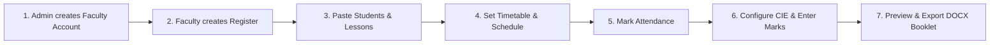

# Faculty Attendance Register System

> A dedicated, local-first academic attendance and evaluation management system built with Python and Django. Designed for engineering institutions (specifically VTU / KSIT curriculum patterns), it streamlines daily attendance tracking, Continuous Internal Evaluation (CIE) grading, and exports print-ready Microsoft Word (`.docx`) booklets matching physical institutional binder specifications.

---

## Table of Contents
1. [Overview & Highlights](#overview--highlights)
2. [Technology Stack](#technology-stack)
3. [System Requirements](#system-requirements)
4. [Quick Setup & Running](#quick-setup--running)
   - [Method 1: One-Click Launcher (Recommended for Windows)](#method-1-one-click-launcher-recommended-for-windows)
   - [Method 2: PowerShell Scripts](#method-2-powershell-scripts)
   - [Method 3: Standard Command Line (Cross-Platform)](#method-3-standard-command-line-cross-platform)
5. [End-to-End Faculty Workflow](#end-to-end-faculty-workflow)
6. [Booklet Geometry & DOCX Export](#booklet-geometry--docx-export)
7. [Project Directory Structure](#project-directory-structure)
8. [Testing & Quality Verification](#testing--quality-verification)
9. [Administrator Guide & Maintenance](#administrator-guide--maintenance)

---

## Overview & Highlights

In higher education, the **Faculty Attendance Register** is a mandatory legal and academic logbook. Faculty are required to record lesson execution, individual student period-wise attendance, and internal assessment marks.

This application replaces error-prone pen-and-paper tracking and rigid cloud ERPs with a focused, secure, on-premise system:

- 📋 **Multi-Course Management**: Maintain separate, private registers partitioned by department, semester, section, and subject.
- ⚡ **Rapid Batch Paste**: Import student rosters (USN, Name, Eligibility dates), syllabus lesson plans, and marks directly from Excel/Word or CSV.
- 🗓️ **Intelligent Scheduling**: Map lesson plans to weekly timetables automatically, detect holiday conflicts, and accommodate extra or rescheduled classes.
- 👥 **Interactive Attendance Grid**: Real-time running attendance counter, explicit absence (`Red A`) recording, student enrollment eligibility enforcement, and an atomic "Complete Class" operation.
- 📊 **Configurable CIE Scoring Engine**: Flexible assessment rules supporting assignment and internal test weightages, best-of-$N$ test aggregation, absence handling (`AB`), and precision rounding.
- 📄 **Exact Physical Booklet DOCX Synthesis**: Programmatically renders complete 12-page booklets adhering to custom physical paper dimensions (210 × 307 mm full pages and 105 × 307 mm half-leaves) with official institution headers and cryptographic SHA-256 data snapshots.
- 🔒 **Local & Privacy-Preserving**: Runs completely on your local network or PC with SQLite. No third-party cloud data transmission, recurring subscriptions, or external dependencies.

---

## Technology Stack

| Component | Technology | Purpose |
| :--- | :--- | :--- |
| **Backend Framework** | Python 3.12, Django 5.x | Core business logic, ORM, authentication, and routing |
| **Database** | SQLite 3 (`var/register.sqlite3`) | Fast, zero-configuration local relational database |
| **Document Synthesis** | `python-docx` | Custom XML-level Word document generation with exact twip geometry |
| **Frontend** | Vanilla HTML5, CSS3, Modern JavaScript | Responsive UI, print preview, and fast client-side paste validation |
| **Test Suites** | `pytest`, `pytest-django`, Playwright | Unit math tests, database integration tests, and headless browser tests |
| **Code Quality** | `ruff` | Fast Python linting and formatting validation |

---

## System Requirements

- **Operating System**: Windows 10/11, macOS, or Linux (Windows recommended for official PowerShell launchers).
- **Python**: Version **3.12** or higher (must be added to system `PATH`).
- **Web Browser**: Microsoft Edge, Google Chrome, or Mozilla Firefox.
- **Word Processor**: Microsoft Word 2016+ or LibreOffice (for opening exported `.docx` booklets).

---

## Quick Setup & Running

Choose any of the three methods below to start the application:

### Method 1: One-Click Launcher (Recommended for Windows)

1. Open the project root folder in File Explorer.
2. **Double-click `Start Faculty Register.cmd`**.
3. If this is your first time running, a prompt will ask you to set an **Administrator Username and Password**.
4. The application will automatically initialize the database, start the server, and open your web browser at:
   ```
   http://127.0.0.1:8000/
   ```

---

### Method 2: PowerShell Scripts

Open PowerShell in the project directory and run:

```powershell
# 1. Setup virtual environment, dependencies, and database:
powershell -ExecutionPolicy Bypass -File scripts/windows/setup-development.ps1

# 2. Launch the application:
powershell -ExecutionPolicy Bypass -File scripts/windows/start-development.ps1
```

*Note: On first setup, you will be prompted to create your administrator credentials. To skip admin creation on subsequent setups, add `-SkipAdministrator`.*

---

### Method 3: Standard Command Line (Cross-Platform)

For developers using Command Prompt, Git Bash, or Linux/macOS terminals:

```bash
# 1. Create a Python 3.12 virtual environment
python -m venv .venv

# 2. Activate the virtual environment
# Windows (PowerShell):
.\.venv\Scripts\Activate.ps1
# Windows (cmd.exe):
.\.venv\Scripts\activate.bat
# Linux / macOS:
source .venv/bin/activate

# 3. Install locked dependencies
pip install -r requirements.lock

# 4. Run database migrations
python manage.py migrate

# 5. Create the initial administrator account
python manage.py bootstrap_admin

# 6. Start the local development server
python manage.py runserver 127.0.0.1:8000
```

Open [http://127.0.0.1:8000](http://127.0.0.1:8000) in your web browser.

---

## End-to-End Faculty Workflow

Once the application is running, follow these steps to manage an academic register:



### Step 1: Sign In & Manage Accounts
- Sign in at `/login/` with your credentials.
- Administrators can click **Faculty accounts** in the top navigation to create logins for individual teachers.
- Each faculty member only sees and edits their own assigned registers.

### Step 2: Create a Course Register
- From the Dashboard, click **New Register**.
- Enter the **Department / Branch**, **Semester**, **Section**, **Subject Name & Code**, and **Academic Term Dates**.
- Click **Create Register**.

### Step 3: Add Students and Lesson Plans
- Open your register and select **Students, attendance & marks**.
- **Students Tab**: Type student USNs and Names or click **Paste rows** to copy-paste directly from an Excel/CSV column (`USN, Name, Eligible From`).
- **Lessons Tab**: Paste your syllabus topics and planned teaching periods (`Lesson #, Topic, Planned Date, Period`).

### Step 4: Timetable & Session Scheduling
- **Timetable Tab**: Define your recurring weekly class periods (e.g., Monday Period 2, Wednesday Period 4).
- **Classes & Tests Tab**: Click **Apply Timetable** to automatically project all planned lessons across the calendar term.
- **Holidays Tab**: Declare college holidays or unexpected closures; the system automatically detects timetable clashes and flags them for review without silent data corruption.

### Step 5: Mark Attendance
- **Attendance Tab**: Displays an interactive matrix of students vs. scheduled classes.
- Click any session column to open the marking interface:
  - Mark absences (saved as red **`A`**).
  - Unmarked students default to present upon clicking **Complete Class**.
  - Late-joiner eligibility dates are automatically respected (shown as dashes `-`).
  - View live cumulative attendance percentages calculated automatically through each session.

### Step 6: Configure CIE Scoring & Enter Marks
- **Rules Tab**: Set maximum marks and percentage contributions for Assignments and Internal Tests (e.g., 2 Assignments + Best 2 of 3 Tests).
- **Marks Tab**: Enter student marks or copy-paste columns from Excel. The system validates maximum limits, flags absent students (`AB`), and computes final weighted scores and roundings.

### Step 7: Live Preview & Word Booklet Export
- **Preview Tab**: View a high-fidelity, real-time web rendering of the 12-page booklet directly in your browser.
- **Exports Tab**: Select a date cutoff and click **Issue Final DOCX Export**. The system generates a formatted `.docx` file matching the college's physical booklet dimensions.
- Downloaded documents automatically save to your system's `downloads/` folder.

---

## Booklet Geometry & DOCX Export

The export engine generates a 12-page document matching the physical register booklet used by affiliated institutions:

| Page # | Content | Sheet Dimensions | Physical Description |
| :---: | :--- | :---: | :--- |
| **Page 1** | Course Details & Lesson Plan (Rows 1–20) | 210 × 307 mm | Full-width opening leaf |
| **Page 2** | Lesson Plan Continuation (Rows 21–45) | 210 × 307 mm | Full-width leaf |
| **Page 3** | Lesson Plan Completion & Signatures (Rows 46–70) | 210 × 307 mm | Full-width leaf |
| **Page 4** | Student Roster & Sessions 1–10 | 210 × 307 mm | Full-width opening attendance sheet |
| **Pages 5–10** | Intermediate Attendance Sessions 11–70 | 105 × 307 mm | **Half-width leaves** (flip without hiding student USNs) |
| **Page 11** | Closing Sessions 71–75 & Final CIE Marks Table | 210 × 307 mm | Full-width closing assessment sheet |
| **Page 12** | Faculty Weekly Timetable & Review Signatures | 210 × 307 mm | Full-width interior insert sheet |

*All exported Word documents include an immutable SHA-256 snapshot checksum recorded in the database for academic audit verification.*

---

## Project Directory Structure

```text
Attendance_Register/
├── manage.py                          # Django management CLI script
├── pyproject.toml                     # Project packaging and metadata
├── requirements.lock                  # Pinned production dependencies
├── requirements-dev.lock              # Pinned development/testing dependencies
├── Start Faculty Register.cmd         # Windows one-click desktop launcher
│
├── accounts/                          # Faculty authentication and user profiles
├── assessments/                       # Continuous Internal Evaluation (CIE) scoring engine
├── attendance/                        # Attendance grid, state machine, and percentages
├── config/                            # Core Django settings, URLs, and WSGI configuration
├── core/                              # Base models, date helpers, and form validators
├── exports/                           # Booklet geometry renderer and DOCX generator
├── operations/                        # Database backup, restore, and runtime diagnostics
├── registers/                         # Register lifecycle, student rosters, and lesson plans
├── scheduling/                        # Timetable engine, calendar slots, and holiday clash detector
│
├── static/                            # CSS stylesheets, JavaScript helpers, and KSIT logo
│   ├── css/                           # Modern application and print preview styles
│   └── img/                           # Institutional branding logos
├── templates/                         # HTML5 UI templates (registers, preview, accounts)
├── tests/                             # Comprehensive automated test suites
│   ├── unit/                          # Math, geometry, scoring, and paste parsing tests
│   ├── integration/                   # HTTP workflows, model transactions, and permissions
│   ├── browser/                       # Playwright browser end-to-end automation tests
│   └── fixtures/                      # Synthetic 12-page booklet test data
│
├── docs/                              # Detailed engineering and user documentation
│   ├── faculty-guide.md               # Detailed step-by-step faculty user manual
│   ├── print-guide.md                 # Physical printing, margins, and paper assembly instructions
│   ├── windows-setup.md               # Production Windows server and HTTPS deployment
│   └── verification.md                # Test execution logs and evidence records
└── var/                               # Local SQLite database and backups (git-ignored)
```

---

## Testing & Quality Verification

The repository includes a comprehensive automated test suite. Run the checks using the virtual environment:

```powershell
# 1. Run all Unit and Integration tests:
.\.venv\Scripts\python.exe -m pytest tests/unit tests/integration -q

# 2. Run Browser End-to-End tests (via Playwright / Microsoft Edge):
.\.venv\Scripts\python.exe -m pytest tests/browser -q --browser chromium --browser-channel msedge

# 3. Generate a synthetic 12-page Word booklet without touching saved records:
.\.venv\Scripts\python.exe manage.py render_booklet_fixture --output artifacts/booklet-sample.docx

# 4. Verify Django models, migrations, and system integrity:
.\.venv\Scripts\python.exe manage.py check
.\.venv\Scripts\python.exe manage.py makemigrations --check --dry-run

# 5. Run Python code style and linter checks:
.\.venv\Scripts\python.exe -m ruff check .
```

---

## Administrator Guide & Maintenance

### 1. Stopping the Server
In the command prompt or terminal running the application, press **`Ctrl + C`** to gracefully shut down the server.

### 2. Password Recovery
If an administrator or faculty member forgets their password, reset it from the terminal:
```powershell
.\.venv\Scripts\python.exe manage.py changepassword <username>
```

### 3. Backing Up Database Records
Administrators can download a full backup directly from the web interface at `/admin/backups/`, or run the command line backup tool:
```powershell
.\.venv\Scripts\python.exe manage.py backup_registers --output var/backups/
```

### 4. Restoring from a Backup
To restore records from an existing backup ZIP:
```powershell
.\.venv\Scripts\python.exe manage.py restore_registers var/backups/register-YYYYMMDD-XXXXXX.zip
```

---

## License & Institutional Context
Developed for **K.S. Institute of Technology (KSIT)** and affiliated technical education colleges. Designed to satisfy university audit and academic inspection criteria under the Visvesvaraya Technological University (VTU) curriculum framework.
